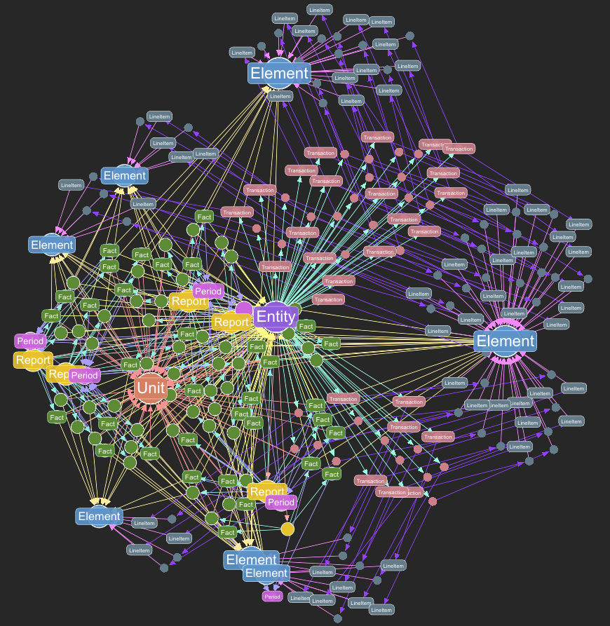

# Accounting Demo - Complete Guide

This guide walks you through the RoboSystems Accounting Demo, showcasing how graph databases transform traditional accounting workflows into powerful, queryable knowledge graphs.

## Overview

The Accounting Demo demonstrates RoboSystems' capabilities for accounting and financial data management by creating a complete double-entry bookkeeping system in a graph database. This approach offers:

- **Full Transaction Lineage**: Trace every dollar through the complete accounting cycle
- **Real-time Financial Reports**: Generate trial balances, income statements, and cash flow reports instantly
- **Flexible Analysis**: Run ad-hoc queries without predefined reports
- **Audit Trail**: Complete transaction history with relationship tracking
- **Graph-native Accounting**: Leverage graph relationships for multi-dimensional analysis
- **AI-Powered Financial Analysis**: Query demo accounting data using natural language through any MCP-compatible AI tool

**What gets created:**

- **1 Entity**: Acme Consulting LLC (fictional consulting company)
- **20 Accounts**: Complete chart of accounts (Assets, Liabilities, Equity, Revenue, Expenses)
- **~180 Transactions**: 6 months of realistic business activity
- **~360 Line Items**: Double-entry journal entries with debits and credits
- **Graph Relationships**: Transaction lineage and account mappings

## Prerequisites

Before starting, ensure you have:

- Docker running locally
- RoboSystems development environment set up
- Services started with `just start`

## Quick Start

The fastest way to run the complete demo:

```bash
# Ensure RoboSystems is running
just start

# Run complete workflow
just demo-accounting
```

**What this does:**

1. Creates user account and API key
2. Creates a new graph database
3. Generates 6 months of accounting data
4. Uploads and ingests data into the graph
5. Runs verification queries with beautiful table output

**First run**: Takes ~2-3 minutes to complete all steps.

**Subsequent runs**: Reuses credentials and graph (~30 seconds).

**Command syntax**: `just demo-accounting [flags] [base_url]`
- Flags are comma-separated: `new-user,new-graph,skip-queries`
- Base URL defaults to `http://localhost:8000`

### Quick Start Options

```bash
# Start fresh with new user and graph
just demo-accounting new-user,new-graph

# Create new graph (keep existing user)
just demo-accounting new-graph

# Skip verification queries
just demo-accounting skip-queries

# Combine multiple flags
just demo-accounting new-user,new-graph,skip-queries
```

## Step-by-Step Walkthrough

The `just demo-accounting` command runs all 5 steps automatically. This section explains what happens during each step. To run individual steps manually, use the Python scripts directly (see examples below).

### Step 1: Setup Credentials (`01_setup_credentials.py`)

**What happens automatically:**
- Creates new user in PostgreSQL database
- Generates API key for authentication
- Stores credentials locally in `examples/credentials/config.json`

**Control via flags:**
```bash
just demo-accounting new-user  # Force new credentials
```

**Manual execution (if needed):**
```bash
uv run examples/accounting_demo/01_setup_credentials.py
uv run examples/accounting_demo/01_setup_credentials.py --force  # Force new
```

### Step 2: Create Graph Database (`02_create_graph.py`)

**What happens automatically:**
- Creates new Ladybug graph database
- Registers graph with user account
- Stores graph_id in `credentials/config.json` for subsequent operations

**Control via flags:**
```bash
just demo-accounting new-graph  # Force new graph
```

**Manual execution (if needed):**
```bash
uv run examples/accounting_demo/02_create_graph.py
uv run examples/accounting_demo/02_create_graph.py --reuse  # Reuse existing
```

### Step 3: Generate Accounting Data (`03_generate_data.py`)

**What happens automatically:**
- Generates 6 months of transaction data (default)
- Creates Parquet files in `examples/accounting_demo/data/` directory
- Includes: Entity, Element, Transaction, LineItem, and relationship files
- Validates double-entry bookkeeping (debits = credits)

**Generated data includes:**
- Monthly Revenue (consulting and training with realistic variation)
- Monthly Expenses (rent, salaries, utilities, office supplies, marketing)
- Balance Sheet Accounts (cash, accounts receivable/payable, equipment)
- Equity Accounts (common stock, retained earnings)
- Double-Entry Validation (every transaction balances)

**Note:** Data is automatically regenerated on every run.

**Manual execution (if needed):**
```bash
uv run examples/accounting_demo/03_generate_data.py
uv run examples/accounting_demo/03_generate_data.py --months 12  # More data
```

### Step 4: Upload and Ingest (`04_upload_ingest.py`)

**What happens automatically:**

1. **Upload**: Files uploaded to S3 (LocalStack in development)
2. **Stage**: Data loaded into DuckDB staging tables
3. **Validate**: Automatic data quality checks
4. **Ingest**: DuckDB → Ladybug graph database via extension
5. **Verify**: Counts verified, relationships checked

**Manual execution (if needed):**
```bash
uv run examples/accounting_demo/04_upload_ingest.py
```

### Step 5: Query the Graph (`05_query_graph.py`)

**What happens automatically:**
- Executes all 15 preset financial queries
- Displays results in formatted Rich tables
- Shows trial balance, income statement, profitability, and more

**Control via flags:**
```bash
just demo-accounting skip-queries  # Skip this step
```

**Manual execution (if needed):**
```bash
# Run all presets
uv run examples/accounting_demo/05_query_graph.py --all

# Run specific preset
uv run examples/accounting_demo/05_query_graph.py --preset trial_balance

# Interactive query mode - opens interactive prompt for custom queries
uv run examples/accounting_demo/05_query_graph.py
```

**Interactive Mode Highlights:**
- Enter custom Cypher queries on the fly
- Run preset queries by name (e.g., `trial_balance`, `profitability`)
- Type `all` to run all presets
- Results display in beautiful Rich tables
- Perfect for exploring your accounting data interactively

**After the demo completes**, see the [Available Financial Reports](#available-financial-reports) and [Interactive Query Mode](#interactive-query-mode) sections below.

## Available Financial Reports

All queries display with professional Rich table formatting showing financial data clearly aligned and formatted.

### Chart of Accounts

View the complete chart of accounts with account types and normal balances:

```bash
uv run examples/accounting_demo/05_query_graph.py --preset chart_of_accounts
```

**Output:**
```
                 View chart of accounts
┏━━━━━━━━━━━━━━━━━━━━━┳━━━━━━━━━━━┳━━━━━━━━━━━━━━━━┓
┃ account             ┃ type      ┃ normal_balance ┃
┡━━━━━━━━━━━━━━━━━━━━━╇━━━━━━━━━━━╇━━━━━━━━━━━━━━━━┩
│ Cash                │ asset     │ debit          │
│ AccountsReceivable  │ asset     │ debit          │
│ ConsultingRevenue   │ revenue   │ credit         │
│ Salaries            │ expense   │ debit          │
└─────────────────────┴───────────┴────────────────┘
```

### Trial Balance

Calculate account balances using double-entry bookkeeping:

```bash
uv run examples/accounting_demo/05_query_graph.py --preset trial_balance
```

**Output:**
```
                Calculate trial balance
┏━━━━━━━━━━━━┳━━━━━━━┳━━━━━━━━━━━━━┳━━━━━━━━━━━━━━┳━━━━━━━━━━━━┓
┃ account    ┃ type  ┃ total_debits┃ total_credits┃ net_balance┃
┡━━━━━━━━━━━━╇━━━━━━━╇━━━━━━━━━━━━━╇━━━━━━━━━━━━━━╇━━━━━━━━━━━━┩
│ Cash       │ asset │ 124,901.57  │ 85,450.17    │ 39,451.40  │
│ Revenue    │ rev   │ 0.00        │ 124,901.57   │ -124,901.57│
│ Salaries   │ exp   │ 62,962.89   │ 0.00         │ 62,962.89  │
└────────────┴───────┴─────────────┴──────────────┴────────────┘
```

**Cypher Query:**

```cypher
MATCH (li:LineItem)-[:LINE_ITEM_RELATES_TO_ELEMENT]->(e:Element)
WITH
    e.name AS account,
    e.classification AS type,
    sum(li.debit_amount) AS total_debits,
    sum(li.credit_amount) AS total_credits
RETURN
    account,
    type,
    total_debits,
    total_credits,
    total_debits - total_credits AS net_balance
ORDER BY account
```

### Income Statement

View revenue and expenses to determine profitability:

```bash
uv run examples/accounting_demo/05_query_graph.py --preset income_statement
```

**Cypher Query:**

```cypher
MATCH (li:LineItem)-[:LINE_ITEM_RELATES_TO_ELEMENT]->(e:Element)
WHERE e.classification IN ['revenue', 'expense']
WITH
    e.classification AS category,
    e.name AS account,
    sum(li.credit_amount) - sum(li.debit_amount) AS amount
RETURN category, account, amount
ORDER BY category, account
```

### Cash Flow Analysis

Track all transactions affecting the Cash account:

```bash
uv run examples/accounting_demo/05_query_graph.py --preset cash_flow
```

**Cypher Query:**

```cypher
MATCH (t:Transaction)-[:TRANSACTION_HAS_LINE_ITEM]->(li:LineItem)
      -[:LINE_ITEM_RELATES_TO_ELEMENT]->(e:Element)
WHERE e.name = 'Cash'
RETURN
    t.date AS date,
    t.description AS description,
    li.debit_amount AS cash_in,
    li.credit_amount AS cash_out
ORDER BY t.date DESC
LIMIT 20
```

### Revenue Trends

Analyze revenue by month:

```bash
uv run examples/accounting_demo/05_query_graph.py --preset revenue_by_month
```

**Cypher Query:**

```cypher
MATCH (t:Transaction)-[:TRANSACTION_HAS_LINE_ITEM]->(li:LineItem)
      -[:LINE_ITEM_RELATES_TO_ELEMENT]->(e:Element)
WHERE e.classification = 'revenue'
RETURN
    substring(t.date, 1, 7) AS month,
    sum(li.credit_amount) AS total_revenue
ORDER BY month
```

### Profitability Analysis

Monthly profit/loss calculation:

```bash
uv run examples/accounting_demo/05_query_graph.py --preset profitability
```

**Output:**
```
        Profitability by month (Revenue - Expenses)
┏━━━━━━━━━┳━━━━━━━━━━━┳━━━━━━━━━━━┳━━━━━━━━━━━┓
┃ month   ┃ revenue   ┃ expenses  ┃ profit    ┃
┡━━━━━━━━━╇━━━━━━━━━━━╇━━━━━━━━━━━╇━━━━━━━━━━━┩
│ 2025-05 │ 20,726.01 │ 13,115.65 │ 7,610.36  │
│ 2025-06 │ 21,422.14 │ 12,570.74 │ 8,851.40  │
│ 2025-07 │ 22,156.29 │ 14,750.07 │ 7,406.22  │
└─────────┴───────────┴───────────┴───────────┘
```

### All Available Presets

The demo includes 15 preset queries:

1. **counts** - Count all nodes by type
2. **chart_of_accounts** - View chart of accounts
3. **trial_balance** - Calculate trial balance
4. **income_statement** - Revenue & Expenses
5. **cash_flow** - Cash flow transactions
6. **revenue_by_month** - Revenue trends
7. **expense_by_month** - Expense trends
8. **profitability** - Monthly profit/loss
9. **top_expenses** - Top expense categories
10. **recent_transactions** - Most recent transactions
11. **monthly_reports** - List financial reports
12. **report_summary** - Report facts summary
13. **account_facts** - Aggregated facts by account
14. **report_lineage** - Data lineage from transactions to reports
15. **full_reporting_structure** - Complete reporting hierarchy

## Interactive Query Mode

After running the demo, you can explore your accounting data interactively with a built-in query prompt:

```bash
uv run examples/accounting_demo/05_query_graph.py
```

This launches an interactive session where you can:

**Run Preset Queries by Name:**
```
> trial_balance
> profitability
> cash_flow
```

**Execute Custom Cypher Queries:**
```
> MATCH (t:Transaction) WHERE t.date >= '2025-09-01' RETURN t.date, t.description, t.type ORDER BY t.date DESC LIMIT 10
```

**Run All Presets at Once:**
```
> all
```

**Exit the Session:**
```
> quit
```

**Features:**
- **Beautiful Tables**: All results display in Rich-formatted tables
- **Instant Feedback**: See results immediately after each query
- **Explore Freely**: Test different queries without rerunning the script
- **Learning Tool**: Great for learning Cypher query patterns
- **No API Key Required**: Connects directly to the graph database

This interactive mode is perfect for:
- **Exploring** your accounting data without writing Python scripts
- **Testing** new query patterns before using them in production
- **Learning** Cypher by experimenting with different queries
- **Debugging** data issues or validating ingestion
- **Presenting** financial data to stakeholders interactively

## Understanding the Data Model

The accounting demo uses a graph-native approach to double-entry bookkeeping.

### Node Types

**Entity**
- Represents the business entity (Acme Consulting LLC)
- Properties: `identifier`, `name`, `industry`, `jurisdiction`

**Element**
- Individual accounts in the chart of accounts
- Properties: `identifier`, `name`, `classification`, `balance`, `period_type`
- Classifications: `asset`, `liability`, `equity`, `revenue`, `expense`

**Transaction**
- Business transactions (invoices, payments, expenses)
- Properties: `identifier`, `date`, `description`, `type`

**LineItem**
- Journal entry lines (debits and credits)
- Properties: `identifier`, `debit_amount`, `credit_amount`, `description`

**Report** (optional)
- Financial reports linking to XBRL facts
- Properties: `identifier`, `name`, `form`, `report_date`, `fiscal_year`, `fiscal_period`

**Fact** (optional)
- XBRL-style financial metrics
- Properties: `identifier`, `value`, `numeric_value`, `decimals`

**Period** (optional)
- Time contexts for facts
- Properties: `identifier`, `instant_date`, `start_date`, `end_date`

### Relationship Types

**TRANSACTION_HAS_LINE_ITEM**
- Links transactions to their journal entry lines
- Represents the composition of a transaction

**LINE_ITEM_RELATES_TO_ELEMENT**
- Links journal entries to chart of accounts
- Maps debits/credits to specific accounts

**ENTITY_HAS_REPORT** (optional)
- Links business entity to financial reports

**REPORT_HAS_FACT** (optional)
- Links reports to individual financial metrics

**FACT_HAS_ELEMENT** (optional)
- Links facts to account definitions

**FACT_HAS_PERIOD** (optional)
- Links facts to time periods

### Graph Traversal Example

```
Transaction (Invoice #1234, 2025-05-15)
  -[:TRANSACTION_HAS_LINE_ITEM]-> LineItem (Debit: $5,000)
    -[:LINE_ITEM_RELATES_TO_ELEMENT]-> Element (Accounts Receivable)
  -[:TRANSACTION_HAS_LINE_ITEM]-> LineItem (Credit: $5,000)
    -[:LINE_ITEM_RELATES_TO_ELEMENT]-> Element (Consulting Revenue)
```

This represents: *Invoiced $5,000 for consulting services, increasing Accounts Receivable (debit) and Consulting Revenue (credit).*

## Accessing with MCP Client (For AI Agents)

You can access the demo accounting graph through any MCP-compatible AI tool (Claude Desktop, Claude Code, Cursor, Cline, etc.) using the MCP protocol.

**Setup MCP Client:**

1. Run `just demo-accounting` to create credentials automatically (your API key is saved to `examples/credentials/config.json`)

2. Get your API key and graph ID from the credentials file:
```bash
cat examples/credentials/config.json | grep -E "api_key|graph_id"
```

3. Add to your MCP tool config. For Claude Desktop:

```json
{
  "mcpServers": {
    "robosystems": {
      "command": "npx",
      "args": ["-y", "@robosystems/mcp"],
      "env": {
        "ROBOSYSTEMS_API_URL": "http://localhost:8000",
        "ROBOSYSTEMS_API_KEY": "rfsabc123xyz...",
        "ROBOSYSTEMS_GRAPH_ID": "your-graph-id"
      }
    }
  }
}
```

**Important:** Replace `rfsabc123xyz...` with your actual API key and `your-graph-id` with your actual graph ID from the credentials file.

4. Restart your MCP-compatible AI tool

5. The MCP server provides these tools:
   - `get-graph-schema` - View available node and relationship types
   - `read-graph-cypher` - Run Cypher queries
   - `discover-properties` - Explore node properties
   - `get-example-queries` - Get sample queries

**Example MCP Usage:**

```
You: Show me the trial balance for the accounting demo

The AI will use:
1. get-graph-schema to understand the accounting structure
2. discover-properties to find Element and LineItem properties
3. read-graph-cypher to calculate trial balance from debits and credits
```

```
You: What were the expenses last month in the demo?

The AI will use:
1. get-graph-schema to understand Transaction relationships
2. read-graph-cypher to query expense transactions by date
3. Present results aggregated by expense category
```

## Querying with just Commands

You can also query the accounting graph using the `just graph-query` command:

```bash
# Count all nodes
just graph-query <graph_id> "MATCH (n) RETURN count(n)"

# View chart of accounts
just graph-query <graph_id> "MATCH (e:Element) RETURN e.name, e.classification ORDER BY e.name"

# Calculate trial balance
just graph-query <graph_id> "MATCH (li:LineItem)-[:LINE_ITEM_RELATES_TO_ELEMENT]->(e:Element) WITH e.name AS account, sum(li.debit_amount) AS debits, sum(li.credit_amount) AS credits RETURN account, debits, credits, debits - credits AS balance ORDER BY account"
```

**Note:** Get your `graph_id` from `credentials/config.json` after running step 2.

## Common Tasks

### Generate More Historical Data

The demo generates 6 months by default. To generate more data, you can run the individual Python scripts directly:

```bash
# Generate 12 months of data
uv run examples/accounting_demo/03_generate_data.py --months 12 --regenerate

# Upload and ingest
uv run examples/accounting_demo/04_upload_ingest.py
```

### Start Fresh

Reset and recreate everything:

```bash
# Delete local credentials and data files
rm -rf examples/credentials/config.json
rm -rf examples/accounting_demo/data/

# Run with new user and graph
just demo-accounting new-user,new-graph
```

### Reuse Existing Setup

Data is automatically regenerated on every run. Simply re-run the demo:

```bash
just demo-accounting
```

### Custom Financial Queries

After running the demo, use the `just graph-query` command for ad-hoc analysis. Get your graph_id from `examples/credentials/config.json`:

```bash
# Find all expenses over $1,000
just graph-query <graph_id> "MATCH (li:LineItem)-[:LINE_ITEM_RELATES_TO_ELEMENT]->(e:Element) WHERE e.classification = 'expense' AND li.debit_amount > 1000 RETURN e.name, li.debit_amount ORDER BY li.debit_amount DESC"

# Calculate total revenue
just graph-query <graph_id> "MATCH (li:LineItem)-[:LINE_ITEM_RELATES_TO_ELEMENT]->(e:Element) WHERE e.classification = 'revenue' RETURN sum(li.credit_amount) AS total_revenue"

# Find transactions by description
just graph-query <graph_id> "MATCH (t:Transaction) WHERE t.description CONTAINS 'Consulting' RETURN t.date, t.description ORDER BY t.date DESC"
```

## Visualizing with G.V()

[G.V()](https://gdotv.com/) is a powerful graph visualization tool and our recommended partner for exploring graph databases interactively. After running the accounting demo, you can visualize the complete accounting structure including entities, accounts, transactions, and their relationships.



*Example: Accounting demo graph visualized in G.V() showing the entity (yellow center), chart of accounts (blue/purple Element nodes), transactions (pink), financial reports (orange), periods (magenta), and units (cyan) with all their relationships in the double-entry bookkeeping system*

### Getting Started with G.V()

1. Visit [https://gdotv.com/](https://gdotv.com/) or download the desktop application
2. Connect to your accounting graph database:
   - **Database Path**: `./data/lbug-dbs/<graph_id>.lbug` (get graph_id from `credentials/config.json`)
3. **Enable "Fetch all edges between vertices"** in settings for richer visualizations
4. Run visualization queries to explore your accounting data

### Visualization Query Examples

```cypher
-- Visualize the complete accounting structure (limit for clarity)
MATCH (e:Entity)-[:ENTITY_HAS_REPORT]->(r:Report)-[:REPORT_HAS_FACT]->(f:Fact)
MATCH (f)-[:FACT_HAS_ELEMENT]->(el:Element)
MATCH (f)-[:FACT_HAS_PERIOD]->(p:Period)
RETURN e, r, f, el, p
LIMIT 20

-- View transaction flow through accounts
MATCH (t:Transaction)-[:TRANSACTION_HAS_LINE_ITEM]->(li:LineItem)
      -[:LINE_ITEM_RELATES_TO_ELEMENT]->(el:Element)
WHERE t.date >= '2025-09-01'
RETURN t, li, el
LIMIT 15

-- Explore chart of accounts relationships
MATCH (el:Element)
WHERE el.classification IS NOT NULL
OPTIONAL MATCH (el)<-[:LINE_ITEM_RELATES_TO_ELEMENT]-(li:LineItem)
RETURN el, li
LIMIT 25

-- Focus on revenue accounts
MATCH (el:Element {classification: 'revenue'})
      <-[:LINE_ITEM_RELATES_TO_ELEMENT]-(li:LineItem)
      <-[:TRANSACTION_HAS_LINE_ITEM]-(t:Transaction)
RETURN el, li, t
LIMIT 20
```

### Visualization Tips

- **Start small**: Use `LIMIT 10-20` to avoid cluttering the visualization
- **Filter by date**: Use `WHERE t.date >= '2025-09-01'` to focus on specific periods
- **Focus on account types**: Filter by classification (`revenue`, `expense`, `asset`, etc.)
- **Click nodes**: Explore properties and relationships interactively
- **Use layouts**: Try different layout algorithms to organize the graph
- **Export images**: Save visualizations for presentations and documentation

## Graph Database Benefits for Accounting

### 1. Relationship Tracking

Traditional accounting systems store transactions in flat tables. Graph databases capture the *relationships* between transactions, accounts, and entities:

```cypher
-- Trace a dollar through the entire accounting cycle
MATCH path = (t:Transaction)-[:TRANSACTION_HAS_LINE_ITEM]->
              (li:LineItem)-[:LINE_ITEM_RELATES_TO_ELEMENT]->(e:Element)
WHERE t.description CONTAINS 'Invoice'
RETURN path
```

### 2. Real-time Financial Reports

No need for pre-computed views or batch processing. Financial reports are generated instantly from the current graph state:

```cypher
-- Real-time balance sheet
MATCH (li:LineItem)-[:LINE_ITEM_RELATES_TO_ELEMENT]->(e:Element)
WHERE e.classification IN ['asset', 'liability', 'equity']
RETURN e.classification, e.name, sum(li.debit_amount - li.credit_amount) AS balance
```

### 3. Audit Trail and Lineage

Complete transaction history with full lineage tracking:

```cypher
-- Full audit trail for an account
MATCH (e:Element {name: 'Cash'})<-[:LINE_ITEM_RELATES_TO_ELEMENT]-
      (li:LineItem)<-[:TRANSACTION_HAS_LINE_ITEM]-(t:Transaction)
RETURN t.date, t.description, li.debit_amount, li.credit_amount
ORDER BY t.date
```

### 4. Multi-dimensional Analysis

Graph queries enable analysis across multiple dimensions without complex SQL joins:

```cypher
-- Profitability by account and month
MATCH (t:Transaction)-[:TRANSACTION_HAS_LINE_ITEM]->(li:LineItem)
      -[:LINE_ITEM_RELATES_TO_ELEMENT]->(e:Element)
RETURN
  substring(t.date, 1, 7) AS month,
  e.name AS account,
  sum(li.credit_amount - li.debit_amount) AS net_amount
ORDER BY month, account
```

### 5. Flexible Schema Evolution

Graph databases adapt easily to new accounting requirements:

- Add new node types (departments, projects, cost centers)
- Add new relationships (allocations, transfers, adjustments)
- Extend existing nodes with properties
- No schema migrations required

## Integration Patterns

The demo showcases patterns used in real RoboSystems integrations:

### XBRL Financial Reporting

The demo includes optional XBRL-style reporting structures (Reports, Facts, Periods) showing how traditional accounting transactions map to regulatory filings:

```cypher
-- Link transactions to XBRL reports
MATCH (t:Transaction)-[:TRANSACTION_HAS_LINE_ITEM]->(li:LineItem)
      -[:LINE_ITEM_RELATES_TO_ELEMENT]->(e:Element)
MATCH (r:Report)-[:REPORT_HAS_FACT]->(f:Fact)-[:FACT_HAS_ELEMENT]->(e)
RETURN t.description, e.name, f.value, r.name
```

### QuickBooks Integration

Similar patterns power the QuickBooks integration (`/robosystems/operations/providers/quickbooks_provider.py`):

- Transactions → QuickBooks Invoices/Bills
- LineItems → Journal Entry Lines
- Elements → Chart of Accounts
- Real-time sync with graph queries

### Custom ERP Systems

Any double-entry accounting system can follow this pattern:

1. Extract transactions and journal entries
2. Map to Element (chart of accounts)
3. Create Transaction and LineItem nodes
4. Link with relationships
5. Query with Cypher for analysis

## Troubleshooting

### Demo Fails: "No credentials found"

**Solution:** Let the demo create credentials automatically, or force new credentials:

```bash
just demo-accounting new-user
```

### Demo Fails: "No graph_id found"

**Solution:** Let the demo create a graph automatically, or force new graph:

```bash
just demo-accounting new-graph
```

### Demo Fails: Data Issues

**Solution:** Re-run the demo (data is regenerated automatically):

```bash
just demo-accounting
```

### Connection Error

**Solution:** Ensure RoboSystems services are running:

```bash
just start
docker ps  # Verify containers are running
```

### Import Errors

**Solution:** Install dev dependencies:

```bash
just install
```

### Queries Return No Results

**Solution:** Re-run the demo to reload data:

```bash
just demo-accounting
```

## Next Steps

- **Query Your Data**: Use `just graph-query <graph_id> "..."` for ad-hoc Cypher queries
- **Visualize Your Graph**: See the [Visualizing with G.V()](#visualizing-with-gv) section to explore your accounting graph interactively
- **Learn Cypher**: Explore graph query patterns with [Cypher Manual](https://neo4j.com/docs/cypher-manual/current/introduction/)
- **Generate More Data**: Modify scripts to generate 12+ months for more historical analysis
- **Build Custom Reports**: Create your own financial analysis queries
- **Integrate Your Data**: Adapt the pattern for your accounting system

## Resources

- **Demo Code**: `/examples/accounting_demo/` in the repository
- **G.V() Graph IDE**: [https://gdotv.com/](https://gdotv.com/) - Visualize your accounting graph
- **Cypher Docs**: [Cypher Manual](https://neo4j.com/docs/cypher-manual/current/introduction/)
- **RoboSystems API**: http://localhost:8000/docs (when running locally)
- **Integration Docs**: `/robosystems/operations/providers/` for QuickBooks and XBRL providers

## Support

- GitHub Issues: [robosystems/issues](https://github.com/RoboFinSystems/robosystems/issues)
- Main README: [robosystems/README.md](https://github.com/RoboFinSystems/robosystems/blob/main/README.md)
- Development Guide: [CLAUDE.md](https://github.com/RoboFinSystems/robosystems/blob/main/CLAUDE.md)
