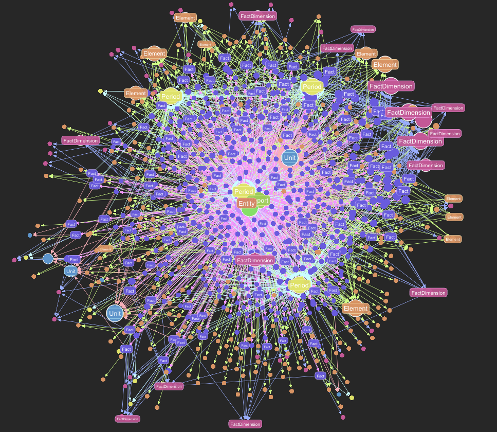

# Getting Started with the SEC XBRL Pipeline

This guide shows you how to load SEC financial data locally and query it using the RoboSystems platform.

**Quick Start:** Run `just demo-sec` to automatically set up everything and see your data in action within minutes!

## Overview

The SEC local pipeline allows you to:

- Load company financial filings (10-K, 10-Q) by ticker symbol
- Store XBRL data in a local Ladybug graph database
- Query financial data using Cypher or the MCP client
- Inspect staged data in DuckDB before ingestion
- Query SEC filings using natural language through any MCP-compatible AI tool

## Prerequisites

Before starting, ensure you have:

- Docker running locally
- RoboSystems development environment set up
- Services started with `just start`

## Quick Start

### One-Command Setup

The fastest way to get started is with the `demo-sec` command, which handles everything automatically:

```bash
# Load NVIDIA 2025 data with automatic setup and example queries (defaults)
just demo-sec

# Load specific company and year
just demo-sec --ticker AAPL --year 2024

# Skip running example queries after setup
just demo-sec --ticker TSLA --year 2023 --skip-queries
```

**What happens automatically:**

1. **User Setup** - Creates demo user with credentials (or reuses existing)
2. **Download** - Fetches XBRL files from SEC EDGAR
3. **Process** - XBRL processors transform data to structured format
4. **Generate** - Creates Parquet files optimized for graph ingestion
5. **Stage** - Uploads to S3 and creates DuckDB staging tables
6. **Validate** - Automatic data quality checks and deduplication
7. **Ingest** - Direct DuckDB → Ladybug via database extension
8. **Subscription** - Subscribes your user to the SEC shared repository (plan `starter` by default)
9. **Config Update** - Updates credentials with SEC graph info
10. **Example Queries** - Runs preset queries showing your data (unless skipped)

SEC access is a **subscription**, not a one-off grant — the shared repository is billed like any other plan. If you only want the subscription and no data:

```bash
# Subscribe only; skip the download/process/ingest pipeline entirely
just demo-sec --subscribe-only

# Or use the dedicated recipe. sec-advanced raises rate limits and credits.
just demo-sec-subscribe                 # sec-starter (default)
just demo-sec-subscribe sec-advanced

# Pick the plan on a full run
just demo-sec --plan sec-advanced
```

**Note:** Setup and loading takes 1-5 minutes depending on the number of years of data.

**Your credentials are saved** to `.local/config.json` with your API key and user information.

### Advanced: Manual Loading

For more control over the loading process, you can use individual commands:

```bash
# Load additional companies after initial setup
just sec-load AMD 2025
just sec-load INTC 2024

# Check database health
just sec-health

# Detailed health check with statistics
just sec-health v
```

The health check shows:

- Database connectivity status
- Number of entities (companies) loaded
- Number of reports (filings) available
- Number of facts (financial metrics)
- Data coverage by year

### Behind the Scenes

The SEC pipeline uses a staging-first architecture. Data goes through DuckDB staging tables before reaching the graph database. This enables validation, transformation, and quality checks before final ingestion.

### Explore Preset Queries

The demo command automatically runs 25 preset queries showing your data — 15 graph queries plus 10 document searches. To explore the data interactively or re-run all queries:

```bash
# Interactive mode (enter queries directly, list presets, run specific ones)
just demo-sec-query

# List every preset without running anything
just demo-sec-query --list
```

In interactive mode (the prompt is `sec>`), you can:
- Type `presets` to list all available queries, graph and search
- Type `preset <name>` to run a specific query (e.g., `preset entities`)
- Type `search <query>` for a full-text search across filings
- Type `search <query> @NVDA` to scope that search to one entity
- Enter custom Cypher queries directly
- Type `help` for available commands
- Type `quit` to exit

**Graph Query Presets (Cypher):**
- `summary` - Node and relationship counts
- `entities` - Public companies with basic info
- `recent_reports` - Most recent SEC filings
- `report_types` - Report form type counts
- `financial_facts` - Sample financial facts
- `fact_dimensions` - Dimensional qualifiers on facts
- `fact_periods` - Facts by time periods
- `elements` - Most commonly used XBRL elements
- `report_structure` - Fact counts per report
- `entity_overview` - Entities with report counts
- `fact_aspects` - Facts with all aspects (Element, Period, Unit)
- `fact_with_dimensions` - Facts with dimensional context
- `taxonomy_structures` - Report taxonomy structures
- `element_hierarchy` - Element parent-child relationships
- `report_taxonomy_detail` - Complete report taxonomy structure

**Document Search Presets (OpenSearch):**
- `risk_factors` - Risk factor disclosures across all entities
- `ai_strategy` - Mentions of AI and machine learning strategy
- `revenue_recognition` - Revenue recognition policy disclosures
- `cybersecurity` - Cybersecurity risk and incident disclosures
- `goodwill_impairment` - Goodwill and impairment discussions
- `segment_reporting` - Operating segment descriptions and breakdowns
- `mda_overview` - Management discussion and analysis highlights (10-K Item 7)
- `mda_quarterly` - Quarterly MD&A highlights (10-Q Item 2)
- `supply_chain` - Supply chain and sourcing disclosures
- `tariff_trade` - Tariff, trade policy, and geopolitical risk mentions (10-K)

## Authentication Setup

The `just demo-sec` command automatically creates user credentials for you. Your API key is saved in `.local/config.json`.

**Important:** The API key (starting with `rfs`) is your authentication credential, not to be confused with the JWT Token and Authorization Header.

**Additional Users (Optional):**

If you need to create additional users with SEC repository access:

```bash
# Create test user with SEC repository access
just demo-user --repositories sec
```

## Accessing the Data

You have multiple options for accessing and querying the loaded SEC data:

1. **[MCP Client](#option-1-mcp-client-for-ai-agents)** - AI agent integration through Claude Desktop
2. **[Direct Cypher Queries](#option-2-direct-cypher-queries-for-development)** - Command-line Cypher queries via `just graph-query`
3. **[Query Staging Tables](#option-3-query-staging-tables-for-data-validation)** - SQL queries on DuckDB staging via `just tables-query`
4. **[Python API](#option-4-python-api-for-applications)** - Programmatic access via RoboSystems Python client
5. **[G.V() Visual Explorer](#option-5-gv-visual-graph-explorer-for-interactive-exploration)** - Interactive graph visualization (recommended tool)
6. **[SQL IDE Tools](#option-6-sql-ide-tools-for-staging-data-validation)** - Direct database access with DuckDB-compatible IDEs

### Option 1: MCP Client (For AI Agents)

Access data through any MCP-compatible AI tool (Claude Desktop, Claude Code, Cursor, Cline, etc.) using the MCP protocol.

**Setup MCP Client:**

1. Run `just demo-sec` to create credentials automatically (your API key is saved to `.local/config.json`)

2. Get your API key from the credentials file:
```bash
cat .local/config.json | grep api_key
```

3. Connect your client. Every graph serves the MCP Streamable HTTP transport directly — one URL plus one header. For Claude Code:

```bash
claude mcp add --transport http robosystems-sec \
  http://localhost:8000/v1/graphs/sec/mcp \
  --header "X-API-Key: <your key>"
```

For Cursor / VS Code (`mcp.json`):

```json
"robosystems-sec": {
  "url": "http://localhost:8000/v1/graphs/sec/mcp",
  "headers": { "X-API-Key": "<your key>" }
}
```

Against production the same URL shape is `https://api.robosystems.ai/v1/graphs/sec/mcp`. Clients without HTTP transport support can use the legacy [stdio bridge](https://github.com/RoboFinSystems/robosystems-mcp-client).

Some clients — claude.ai and Claude Desktop custom connectors among them — have no field for a custom header. For those, the credential travels in the URL instead: `http://localhost:8000/v1/graphs/sec/mcp?token=<graph-scoped API key>`. Only **graph-scoped** keys are accepted this way; an account-wide key in a URL is rejected outright. See [AI Operators & MCP](AI-Operators-and-MCP) for generating one.

4. Restart your MCP-compatible AI tool

5. The MCP server provides these tools:

   **Curated Tools** (no Cypher needed):
   - `financial-statement-analysis` - Structured financial statement by ticker and type (`income_statement`, `balance_sheet`, `cash_flow_statement`, `equity_statement`)
   - `build-fact-grid` - Pivot facts across entities, periods, and dimensions — the multidimensional view over the XBRL hypercube
   - `resolve-element` - Look up XBRL element details by name or canonical concept (uses vector search when available)

   **Graph Tools** (general purpose):
   - `read-graph-cypher` - Run Cypher queries directly
   - `get-graph-schema` - View available node and relationship types
   - `get-graphql-schema` - The typed GraphQL schema served for this graph
   - `query-graphql` - Typed GraphQL reads, as an alternative to raw Cypher
   - `get-graph-info` - Inspect graph topology and node/relationship counts
   - `get-example-queries` - Get sample queries for common patterns
   - `list-subgraphs` - Enumerate this repository's subgraphs and their connector URLs (in production, that includes the deeper `sec_historical` archive)

   **Search Tools** (gated by `SEMANTIC_SEARCH_ENABLED`, which defaults to on):
   - `search-documents` - Full-text search across filing narratives, MD&A, risk factors, and iXBRL disclosures
   - `get-document-section` - Retrieve full text of a document found via search

**Example MCP Usage:**

```
You: What revenue did NVIDIA report in 2024?

The AI will use:
1. financial-statement-analysis with ticker=NVDA, statement_type=income_statement
   → Returns structured revenue, expenses, net income with periods
```

### Option 2: Direct Cypher Queries (For Development)

Query the database directly using Cypher (no authentication required for local queries):

```bash
# List all companies in the database
just graph-query sec "MATCH (e:Entity) RETURN e.name, e.identifier LIMIT 10"

# Get reports for a specific company
just graph-query sec "MATCH (e:Entity)-[:ENTITY_HAS_REPORT]->(r:Report) WHERE e.name CONTAINS 'NVIDIA' RETURN r.form, r.filing_date LIMIT 10"

# Find revenue facts
just graph-query sec "MATCH (f:Fact)-[:FACT_HAS_ELEMENT]->(el:Element) WHERE el.name = 'NetIncomeLoss' RETURN el.name, f.numeric_value, f.value LIMIT 10"
```

**Common Cypher Patterns:**

```cypher
-- Find all facts for a NVDA SEC CIK
MATCH (e:Entity)-[:ENTITY_HAS_REPORT]->(r:Report)-[:REPORT_HAS_FACT]->(f:Fact)
WHERE e.cik = '0001045810'
RETURN f

-- Get balance sheet items
MATCH (f:Fact)-[:FACT_HAS_ELEMENT]->(el:Element)
WHERE el.name STARTS WITH 'Assets'
RETURN el.name, f.numeric_value

-- Find facts by period
MATCH (f:Fact)-[:FACT_HAS_PERIOD]->(p:Period)
WHERE p.instant_date = '2024-01-28'
RETURN f
```

### Option 3: Query Staging Tables (For Data Validation)

Query the DuckDB staging tables to inspect data before it reaches the graph:

```bash
# List all entities in staging
just tables-query sec "SELECT * FROM Entity LIMIT 10"

# Count facts by element
just tables-query sec "SELECT el.name, COUNT(*) as fact_count FROM Fact f JOIN FACT_HAS_ELEMENT fhe ON f.identifier = fhe.src JOIN Element el ON fhe.dst = el.identifier GROUP BY el.name ORDER BY fact_count DESC LIMIT 20"

# Check data quality - find null values
just tables-query sec "SELECT COUNT(*) as null_count FROM Entity WHERE name IS NULL"

# Explore specific company's reports
just tables-query sec "SELECT r.* FROM Report r JOIN ENTITY_HAS_REPORT ehr ON r.identifier = ehr.dst JOIN Entity e ON ehr.src = e.identifier WHERE e.name LIKE '%NVIDIA%'"

# Check available time periods
just tables-query sec "SELECT DISTINCT instant_date FROM Period ORDER BY instant_date DESC LIMIT 10"

# Find revenue facts with full details
just tables-query sec "SELECT f.value, f.numeric_value, p.instant_date, u.measure FROM Fact f JOIN FACT_HAS_ELEMENT fhe ON f.identifier = fhe.src JOIN Element el ON fhe.dst = el.identifier JOIN FACT_HAS_PERIOD fhp ON f.identifier = fhp.src JOIN Period p ON fhp.dst = p.identifier JOIN FACT_HAS_UNIT fhu ON f.identifier = fhu.src JOIN Unit u ON fhu.dst = u.identifier WHERE el.name = 'Revenues' LIMIT 10"
```

**Why Query Staging Tables?**
- **Pre-ingestion validation**: Check data quality before it enters the graph
- **SQL familiarity**: Use SQL joins and aggregations you already know
- **Performance**: DuckDB's columnar storage is extremely fast for analytics
- **Debugging**: Identify issues in source data before graph ingestion

**Available Staging Tables:**
- `Entity` - Companies with SEC CIK identifiers
- `Report` - 10-K and 10-Q filings
- `Fact` - Financial metrics with values
- `Element` - us-gaap metric definitions (with `canonical_concept` from enrichment)
- `Period` - Date/duration contexts
- `Unit` - Measurement units (USD, shares, etc.)
- `Dimension` - Segments and breakdowns
- `Structure` - XBRL presentation/calculation networks (with `canonical_type`)
- `Association` - Parent-child element relationships within structures
- `Classification` - Disclosure type tags on associations (e.g., AssetsRollUp, IncomeStatement)
- `FactSet` - Logical groupings of facts by structure and statement type
- `Label` - Human-readable labels for XBRL elements
- `Reference` - Authoritative references (FASB codification links)
- `Taxonomy` - Global XBRL taxonomy definitions

### Option 4: Python API (For Applications)

Access via the RoboSystems Python client:

```python
from robosystems_client import RoboSystemsClient
from robosystems_client.api.query.execute_cypher import sync_detailed as execute_query
from robosystems_client.models.cypher_statement_request import CypherStatementRequest
import json
from pathlib import Path

# Load API key from credentials file (created by just demo-sec)
credentials_path = Path(".local/config.json")
with open(credentials_path) as f:
    credentials = json.load(f)

# Initialize client with API key
client = RoboSystemsClient(
    base_url="http://localhost:8000",
    token=credentials["api_key"],
    auth_header_name="X-API-Key",
    prefix="",
)

# Run Cypher query
request = CypherStatementRequest(
    query="""
    MATCH (e:Entity)-[:ENTITY_HAS_REPORT]->(r:Report)-[:REPORT_HAS_FACT]->(f:Fact)
    WHERE e.name CONTAINS 'NVIDIA'
    RETURN e.name, r.form, f.numeric_value
    LIMIT 10
    """,
    parameters={},
)

response = execute_query(graph_id="sec", client=client, body=request)

# `parsed` is the decoded JSON body — a dict, not a typed model.
# Keys: success, data, columns, row_count, execution_time_ms, graph_id, timestamp, error
if response.parsed:
    print(f"Results: {response.parsed['data']}")
```

`CypherStatementRequest` also takes an optional `timeout` (seconds, 1–300, default 60).

### Option 5: G.V() Graph IDE For Interactive Exploration

[G.V()](https://gdotv.com/) is a powerful graph visualization tool and our recommended partner for visualizing Ladybug databases:

**Why G.V() for Ladybug?**
- Native Ladybug database support
- Interactive graph exploration
- Real-time Cypher query visualization
- Perfect for understanding complex financial relationships



*Example: Financial report graph visualized in G.V() showing entities, reports, facts, and their relationships*

**Getting Started with G.V():**

1. Visit [https://gdotv.com/](https://gdotv.com/) or download the desktop application
2. Open the application
3. Connect to your local Ladybug database:
   - **Database Path**: `./data/lbug-dbs/sec.lbug` (from RoboSystems root directory)
4. **Enable "Fetch all edges between vertices"** in settings for richer visualizations
5. Run Cypher queries and visualize results interactively

**What you can do:**
- Visualize graph relationships interactively
- Explore entity connections visually
- Debug complex graph patterns
- Understand data model structure
- Click nodes to see properties and relationships
- Export visualizations for presentations

**Example visualization queries:**
```cypher
-- Visualize a company and its reports
MATCH (e:Entity {name: 'NVIDIA CORP'})-[:ENTITY_HAS_REPORT]->(r:Report)
RETURN e, r
LIMIT 5

-- See fact relationships
MATCH (r:Report)-[:REPORT_HAS_FACT]->(f:Fact)-[:FACT_HAS_ELEMENT]->(el:Element)
WHERE r.form = '10-K'
RETURN r, f, el
LIMIT 20

-- Explore full entity context
MATCH (e:Entity)-[:ENTITY_HAS_REPORT]->(r:Report)-[:REPORT_HAS_FACT]->(f:Fact)
WHERE e.cik = '0001045810'
RETURN e, r, f
LIMIT 10
```

**Visualization Tips:**
- Start with small LIMIT values (5-20 nodes) to avoid cluttering
- Use WHERE clauses to filter to specific companies or time periods
- Click nodes to see properties
- Use the layout options to organize the graph

### Option 6: SQL IDE Tools (For Staging Data Validation)

You can open the DuckDB staging database directly in any SQL IDE that supports DuckDB:

**Database Location:**
- **Path**: `./data/staging/sec.duckdb` (from RoboSystems root directory)

**Using DuckDB CLI:**

```bash
# Connect directly to the staging database
duckdb ./data/staging/sec.duckdb

# Run SQL queries interactively
D> SELECT identifier, name, industry FROM Entity LIMIT 10;
D> .tables  # List all tables
D> .schema Entity  # Show table schema
```

**Using SQL IDE Tools:**

Any SQL IDE with DuckDB support can connect to the staging database for visual exploration and querying.

**Example queries:**
```sql
-- See all companies loaded
SELECT identifier, name, industry, ticker FROM Entity;

-- Check facts by year
SELECT
  strftime(CAST(p.instant_date AS DATE), '%Y') as year,
  COUNT(DISTINCT f.identifier) as fact_count
FROM Fact f
JOIN FACT_HAS_PERIOD fhp ON f.identifier = fhp.src
JOIN Period p ON fhp.dst = p.identifier
WHERE p.instant_date IS NOT NULL
GROUP BY year
ORDER BY year DESC;

-- Find largest revenue figures
SELECT
  e.name,
  f.numeric_value,
  p.instant_date
FROM Fact f
JOIN FACT_HAS_ELEMENT fhe ON f.identifier = fhe.src
JOIN Element el ON fhe.dst = el.identifier
JOIN FACT_HAS_PERIOD fhp ON f.identifier = fhp.src
JOIN Period p ON fhp.dst = p.identifier
JOIN REPORT_HAS_FACT rhf ON f.identifier = rhf.dst
JOIN ENTITY_HAS_REPORT ehr ON rhf.src = ehr.dst
JOIN Entity e ON ehr.src = e.identifier
WHERE el.name = 'Revenues'
ORDER BY f.numeric_value DESC
LIMIT 10;
```

**Benefits of Direct SQL Access:**
- Browse all staging tables
- Run SQL queries with full DuckDB features
- Export query results to CSV/JSON
- View table schemas and row counts
- Data quality checks before graph ingestion

## Understanding the Data Model

The SEC graph has 14 node types and 22 relationship types organized around two core traversal patterns.

### Node Types

**Reporting nodes** (the data):
- **Entity** - Companies (e.g., NVIDIA, Apple) with ticker, CIK, industry
- **Report** - SEC filings (10-K, 10-Q) with form type, filing date, fiscal period
- **Fact** - Individual financial data points with `numeric_value` and `value`
- **Element** - XBRL metric definitions (us-gaap tags) with `canonical_concept` (e.g., "revenue", "net_income")
- **Period** - Time contexts (instant dates or duration start/end)
- **Unit** - Measurement units (USD, shares)
- **Dimension** - Dimensional qualifiers (segments, geographic breakdowns)

**Structural nodes** (how data is organized):
- **Structure** - XBRL presentation/calculation networks with `canonical_type` (e.g., "income_statement", "balance_sheet")
- **Association** - Parent-child element relationships within structures (e.g., Revenue rolls up into GrossProfit)
- **Classification** - Disclosure type labels on associations (e.g., AssetsRollUp, IncomeStatement, CashFlowStatement)
- **FactSet** - Logical groupings of facts by structure and statement type

**Reference nodes** (metadata):
- **Label** - Human-readable labels for XBRL elements
- **Reference** - Authoritative references (FASB codification)
- **Taxonomy** - Global XBRL taxonomy definitions

### Key Traversal Patterns

**Pattern 1: Fact-level queries** (individual financial data points)

```
Entity (NVIDIA)
  ─[:ENTITY_HAS_REPORT]─▶ Report (10-K 2024)
    ─[:REPORT_HAS_FACT]─▶ Fact ($26.97B)
      ─[:FACT_HAS_ELEMENT]─▶ Element (us-gaap:Revenues, canonical_concept: "revenue")
      ─[:FACT_HAS_PERIOD]─▶ Period (2024-01-28)
      ─[:FACT_HAS_UNIT]─▶ Unit (USD)
      ─[:FACT_HAS_DIMENSION]─▶ Dimension (optional, for segment breakdowns)
```

**Pattern 2: Statement-level queries** (structured financial statements via FactSets)

```
Structure (canonical_type: "income_statement")
  ─[:STRUCTURE_HAS_FACT_SET]─▶ FactSet
    ─[:FACT_SET_CONTAINS_FACT]─▶ Fact ─[:FACT_HAS_ELEMENT]─▶ Element
                                  └─[:FACT_HAS_ENTITY]─▶ Entity (filter by ticker)
```

This is what `financial-statement-analysis` uses — a single hop from Structure through FactSet to get all facts for a statement type, filtered by company.

**Pattern 3: Taxonomy structure** (how elements relate to each other)

```
Structure
  ─[:STRUCTURE_HAS_ASSOCIATION]─▶ Association
    ─[:ASSOCIATION_HAS_FROM_ELEMENT]─▶ Element (parent, e.g., Assets)
    ─[:ASSOCIATION_HAS_TO_ELEMENT]─▶ Element (child, e.g., CurrentAssets)
    ─[:ASSOCIATION_HAS_CLASSIFICATION]─▶ Classification (type: "AssetsRollUp")
```

### Enriched Properties

During processing, elements and structures are enriched with semantic metadata:

- **`Element.canonical_concept`** — Standardized concept name (e.g., "revenue", "total_assets", "net_income"). Use this for cross-company comparisons instead of raw XBRL qnames.
- **`Structure.canonical_type`** — Statement classification ("income_statement", "balance_sheet", "cash_flow_statement", "equity_statement", "comprehensive_income")
- **`Classification.type`** — Disclosure mechanics label (e.g., "AssetsRollUp", "IncomeStatement", "LongTermDebtMaturities")

## Common Tasks

### Reset Database

If you need to start fresh:

```bash
# Reset database and clear all data
just sec-reset

# Reset and reload company
just sec-reset && just sec-load NVDA 2025
```

### Load Multiple Companies

```bash
# First company with automatic setup
just demo-sec --ticker NVDA --year 2025

# Load additional companies (user already created)
just sec-load AMD 2025
just sec-load INTC 2025

# Verify all loaded
just sec-health v
```

### Find Available Financial Metrics

Use the `read-graph-cypher` MCP tool, or query directly:

```bash
# Find most common us-gaap elements
just graph-query sec "MATCH (el:Element) WHERE el.qname STARTS WITH 'us-gaap:' RETURN el.qname, el.name LIMIT 20"
```

Common financial metrics (XBRL qname → canonical concept):

- `us-gaap:Revenues` → `revenue`
- `us-gaap:NetIncomeLoss` → `net_income`
- `us-gaap:Assets` → `total_assets`
- `us-gaap:Liabilities` → `total_liabilities`
- `us-gaap:StockholdersEquity` → `stockholders_equity`
- `us-gaap:EarningsPerShareBasic` → `eps_basic`
- `us-gaap:OperatingIncomeLoss` → `operating_income`
- `us-gaap:CashAndCashEquivalentsAtCarryingValue` → `cash_and_equivalents`

### Query by Time Period

```bash
# Find all facts from a specific date
just graph-query sec "MATCH (f:Fact)-[:FACT_HAS_PERIOD]->(p:Period) WHERE p.instant_date = '2024-12-31' RETURN COUNT(f)"

# Find facts for a fiscal year
just graph-query sec "MATCH (f:Fact)-[:FACT_HAS_PERIOD]->(p:Period) WHERE p.instant_date >= '2023-01-01' AND p.instant_date < '2025-01-01' RETURN COUNT(f)"
```

## Troubleshooting

### Service Not Running

If you get connection errors:

```bash
# Check services are running
docker ps

# Restart if needed
just restart
```

### Database Empty

If queries return no results:

```bash
# Verify data loaded
just sec-health

# If no data, reload
just sec-load NVDA 2025
```

### Loading Failures

If loading fails:

```bash
# Check Dagster logs (pipeline orchestration)
just logs dagster-webserver

# Check API logs
just logs api

# Reset and try again
just sec-reset
just sec-load NVDA 2025
```

## Next Steps

- **Explore Preset Queries**: Run `just demo-sec-query` to see 25 curated examples — 15 Cypher queries and 10 document searches
- **Visualize with G.V()**: Use our favorite tool [G.V()](https://gdotv.com/) to explore graph relationships interactively
- **Learn Cypher**: Explore graph query patterns with [Cypher Manual](https://neo4j.com/docs/cypher-manual/current/introduction/)
- **Validate Staging**: Use DuckDB CLI or SQL IDEs to inspect staging tables before ingestion
- **Build Analysis**: Use MCP client in Claude for financial analysis with your auto-generated API key
- **Create Reports**: Build automated reporting with Python client
- **Add More Data**: Load additional companies with `just sec-load TICKER YEAR`

## Resources

- **Dagster Pipeline**: See `/robosystems/adapters/sec/pipeline/` for pipeline implementation
- **SEC Adapters**: See `/robosystems/adapters/sec/` for SEC client and processors
- **Health Check**: `just sec-health v` for diagnostic information
- **G.V()**: [https://gdotv.com/](https://gdotv.com/) - Recommended graph visualization tool for Ladybug
- **Cypher Docs**: [Cypher Manual](https://neo4j.com/docs/cypher-manual/current/introduction/)
- **MCP Protocol**: [Model Context Protocol](https://modelcontextprotocol.io/)
- **RoboSystems API**: http://localhost:8000/docs (when running locally)
- **SEC EDGAR**: [SEC Website](https://www.sec.gov/edgar)
- **DuckDB**: [Documentation](https://duckdb.org/docs/) - SQL database for staging
- **Search SEC narratives**: [Search & AI Retrieval](Search-and-AI-Retrieval) - Full-text and semantic search over filing text
- **XBRL taxonomy**: [Taxonomy & Frameworks](Taxonomy-and-Frameworks) - The rs-gaap and fac frameworks behind the facts
- **Query the graph**: [Querying the Analytical Graph](Querying-the-Analytical-Graph) - Ad-hoc Cypher over the SEC graph
- **MCP & operators**: [AI Operators & MCP](AI-Operators-and-MCP) - The MCP retrieval surface
- **Shared repositories**: [Shared Repositories](Shared-Repositories) - SEC as the `ladybug-shared` tier: plans, subscription, and access

## Support

- [Issues](https://github.com/RoboFinSystems/robosystems/issues)
- [Wiki](https://github.com/RoboFinSystems/robosystems/wiki)
- [Projects](https://github.com/orgs/RoboFinSystems/projects)
- [Discussions](https://github.com/orgs/RoboFinSystems/discussions)
